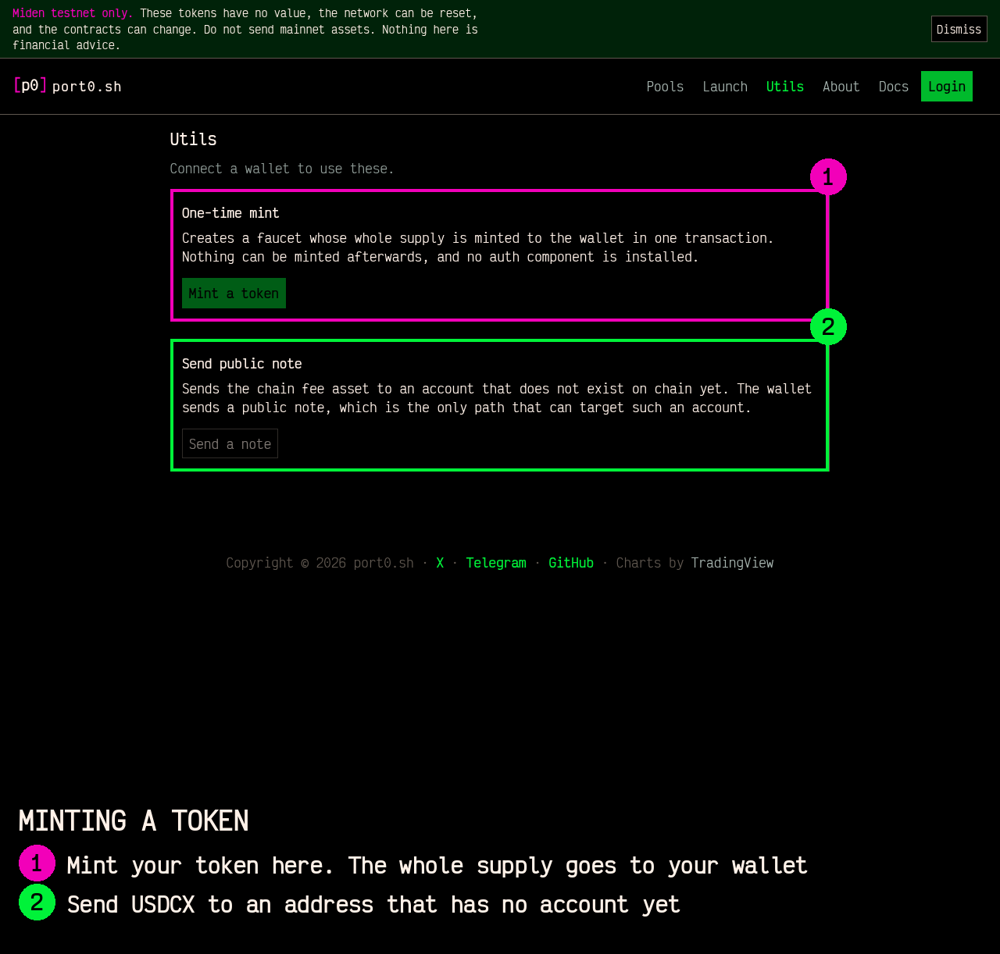
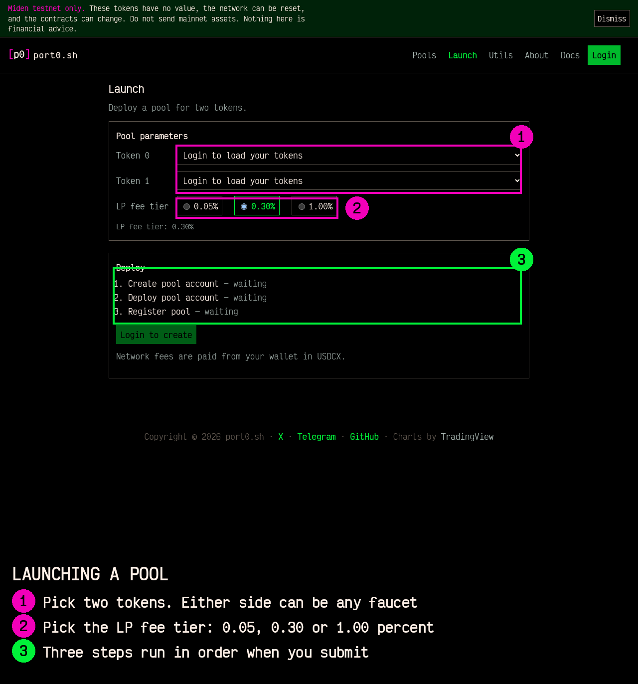
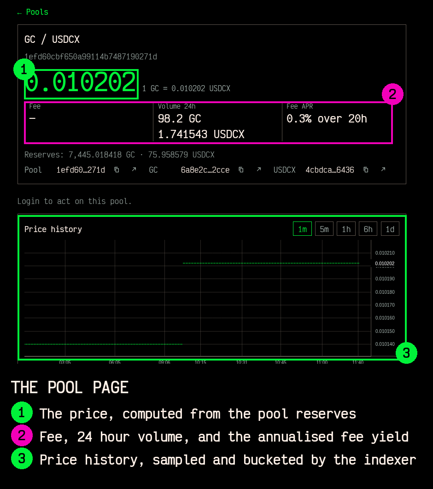

# Open a pool

A token with no market can have one in about ten minutes. This chapter is the
whole flow, from holding a token to having a pool that trades.

## What you need

1. A wallet the app can connect to, holding USDCX.
2. A token. If you do not have one, the app mints one in the next section.
3. Nothing else. There is no application and no approval.

## 1. Get USDCX

Every transaction on Miden pays a fee in the chain's fee asset. On testnet that
is USDCX.

Get it from the faucet at
[faucet.testnet.miden.io](https://faucet.testnet.miden.io). Enter the wallet
address, claim the tokens, and the faucet sends a public note. Claim the note in
the wallet and the balance is spendable.

USDCX pays the network fees for every step below. It is needed here as the fee
asset, not as the other side of the trade. A pool can pair any two tokens, and
the second token does not have to be USDCX.

## 2. Make a token, if you do not have one

Open [port0.sh/utils.html](https://port0.sh/utils.html) and choose One-time mint.

| Field | Rule |
| --- | --- |
| Symbol | 3 to 12 uppercase letters. The protocol rejects digits |
| Name | Optional, up to 32 characters; empty uses the symbol |
| Decimals | 0 to 8 |
| Supply | the whole supply, minted to your wallet in the same flow |

The faucet is created with `maxSupply` equal to the supply, so nothing remains to
mint afterwards. The whole supply ends up in your wallet.

This step creates two transactions and needs 266 base units of USDCX, which the
wallet sends to the new faucet. The faucet's own first transaction pays its own
fee out of that funding.

## 3. Open the pool

Open [port0.sh/create.html](https://port0.sh/create.html) and connect the wallet.

| Field | What to choose |
| --- | --- |
| Token 0 | your token |
| Token 1 | USDCX, or any second token |
| LP fee tier | 0.05 percent, 0.30 percent, or 1.00 percent |

Submit. Three steps run in order.

| Step | What happens | Who pays |
| --- | --- | --- |
| Create the pool account | built locally. The fee rates, the P2ID root, and the registry pointer are initial storage and hold for the pool's life | nothing |
| Deploy | the wallet sends 133 base units of USDCX to the pool, and the app consumes that note as the pool's first transaction | the wallet |
| Register | a register note goes to the registry, which checks the pool's code commitment, its fee values, and the pair | the wallet, plus the registry's register fee |

The register fee on testnet is 119 base units of USDCX. The create page reads it
from the registry and shows it before you submit.

When the third step lands, the page opens the pool's own page.

## 4. Give the pool liquidity

A pool with no reserves has no market. Nobody can trade against it, and it will
not appear useful in the list.

On the pool page, deposit both tokens. The pool mints LP tokens to your wallet in
proportion to your share. After that deposit, the pool has a price, and a swap
against it changes the price.

The first deposit sets the price. Deposit at the ratio you think the pair is
worth, because the market will start there.

## What your pool costs

| Item | Base units of USDCX |
| --- | --- |
| Minting a token, if you need one | 266 |
| Deploying the pool | 133 |
| The register fee | 119 |
| Network fees for each operation | about 119 per swap, about 112 per collect |

A pool created with an existing token costs the deploy and the register fee
only.

## What happens after

1. The pool is in the registry, and the indexer publishes it within about a
   minute. It appears in the list on the home page with its pair, its reserves,
   and its price.
2. The pool page carries the state, a chart, and the three actions: swap, add
   liquidity, remove liquidity.
3. Every swap pays the LP fee into the pool. Liquidity providers hold the LP
   token and share it.
4. The protocol takes a share of the LP fee, fixed by the registry, and it is
   carved out of the LP fee rather than added to the swapper's cost. The swapper
   pays the tier and nothing more.

## If a step fails

The create page keeps its state and offers **Retry** for the step that failed
and **Restart flow**. A retry resumes at the failed step. It does not create a
second pool, and the deploy step reuses the funding note it already sent.

If the register step reports a summary anchor mismatch, a block landed between
two reads. Press retry, which rebuilds the request at the current block.

## What the pool is not

The pool account is public. Anyone can read its reserves, its history, and its
fee rates. There is no private trading here, and the network is a testnet whose
tokens have no value.
